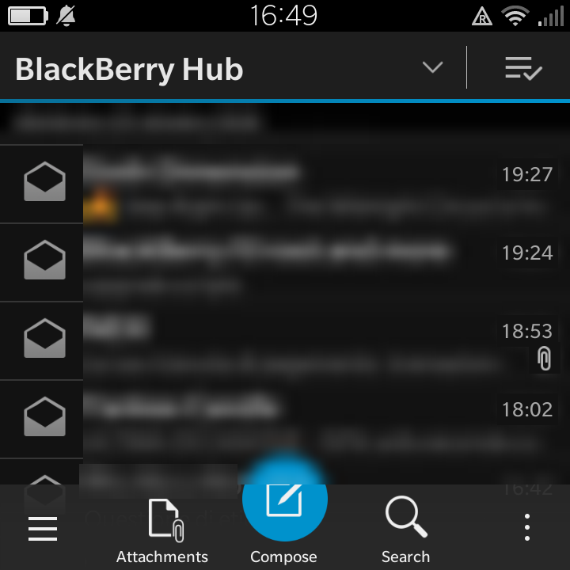
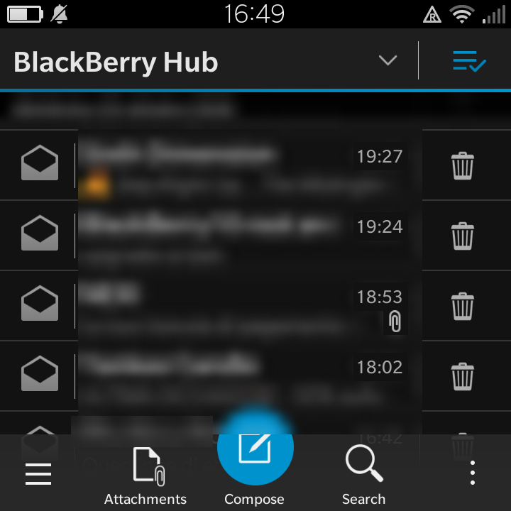
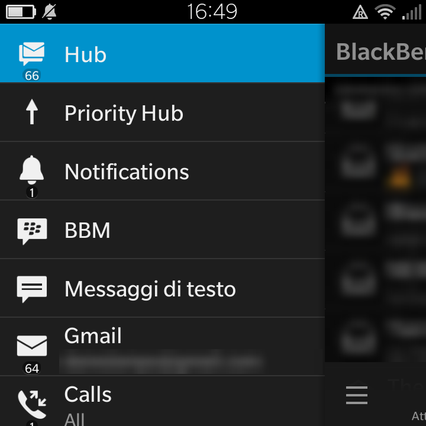
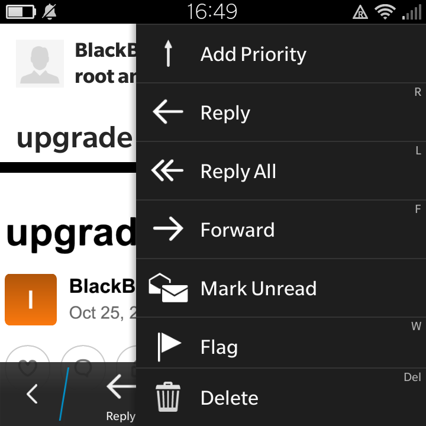
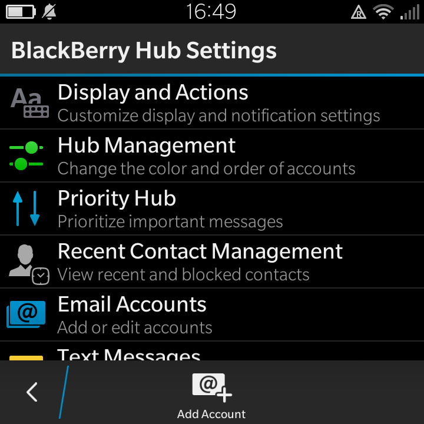

# BB10 dark theme (BlackBerry Hub included)

A dark **BlackBerry Hub** for BlackBerry 10, together with the email viewer,
composer and attachments view, the apps that ignore the system's dark theme.

On the Q10 the system theme is dark out of the box, and the Hub is the bright
exception. On devices whose default theme is bright (e.g. the Q5), a boot addon
switches the whole system to dark as well.

Tested on a BlackBerry Q10 (SQN100-3) running OS 10.3.3.3216.

| Hub | Swipe actions | Menu |
| --- | --- | --- |
|  |  |  |
| **Message actions** | **Hub settings** | |
|  |  | |

(Message senders and previews are blurred.)

## What it does

| Part | How |
| --- | --- |
| Default theme (only if bright) | Cascades apps take their theme from PPS `deviceproperties` (`defaultTheme`) when the app zygote starts. A boot addon sets `black`, restarts the zygote and the apps that are already running. The setting does not survive a reboot, so the addon runs at every boot. At boot, the apps are restarted only when the screen is off and no call is active. `install.sh` installs the addon only when `defaultTheme` is not already `black`, so not on the Q10. |
| Apps that force bright | The Hub, email card, composer and attachments card have `CASCADES_THEME=bright` in their manifest's `Entry-Point`: switched to `dark` (`dark_manifests.sh`). |
| Hub QML | The Hub's QML hardcodes white backgrounds and dark text: backgrounds become `#121212`, text becomes light grey (`hub_dark.sh`). |
| Hub icons | 103 dark-grey PNG icons are replaced by lightened versions: sent and sending status, attachment, flag, lock, archive, swipe actions, file types, S/MIME (`hub_icons_light.sh`, `hub_icons/`). Grey pixels go from black to `#a8a8a8`; coloured pixels are unchanged. |

Before anything is changed, the originals are copied (once) to
`/var/rootdata/manifest_backup`, `hub_qml_backup` and `hub_png_backup`.
Running the scripts again is safe.

## Requirements

- A **root shell** on the phone. The boot addon uses the AutoRoot V4 addon
  mechanism (`/var/addons/<name>/init/start.sh`).
- OS 10.3.x. The icons in `hub_icons/` come from 10.3.3.3216. On another build,
  regenerate them (see below).

## Install

Copy this folder to the phone, then in a root shell:

```sh
cp -r /accounts/1000/shared/downloads/bb10-dark-theme /var/rootdata/darktheme
cd /var/rootdata/darktheme && sh < install.sh
```

Feed the scripts on stdin (`sh < file`): from a root SSH shell, `sh file`
can be refused with "Operation not permitted".
`NOADDON=1` skips the boot addon, for setups where another addon already sets
the theme.

## Uninstall

```sh
sh < /var/rootdata/darktheme/uninstall.sh
```

This restores the original manifests, Hub QML and icons, removes the boot
addon and sets the bright default. Then reboot.

## Regenerate the icons

On a PC with Python 3 and Pillow, from a copy of
`/apps/sys.pim.messages.*/native/assets`:

```sh
python3 tools/make_icons.py assets hub_icons
```

## Notes

- `hub_icons/` contains modified BlackBerry assets, for use on your own device.
  BlackBerry owns the original artwork.
- Contacts and Calendar force the bright theme too, but they have their own
  dark background option in their settings: use that.
- BBM, Chat and RCS also force bright. They are left alone because they have
  not been checked in dark.
- The scripts write only to `/apps/sys.pim.*`, `/var/rootdata` and
  `/var/addons/darktheme`. They never touch `/base`.

## License

The scripts and tools are released under the [MIT license](LICENSE).
The images in `hub_icons/` are not covered by it (see Notes).
